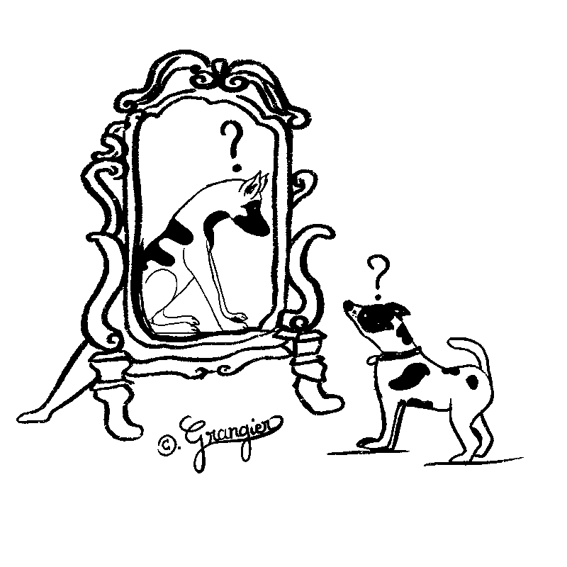
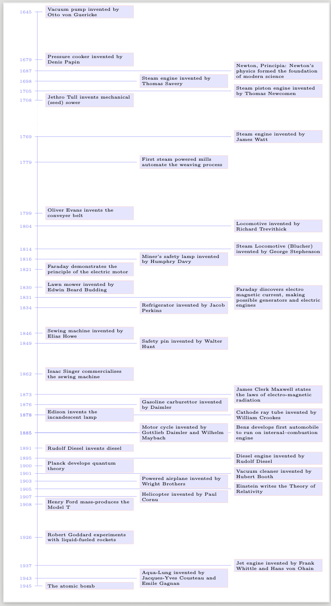
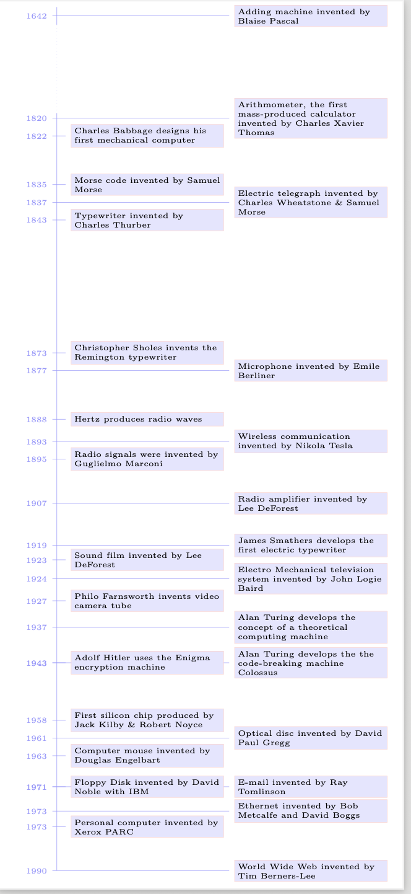

<link rel="stylesheet" href="/Users/aniket/_files/1/marp.css">

<!-- ### Urbanism and Geopolitics -->

### Strategic use of AI in Research

### Kumar Aniket

Associate Professor in Infrastructure, Automation and Economic Transformation  
Institute for Connected Communities  
University of East London 

Director of Studies for Economics
Wolfson College
University of Cambridge 

&nbsp; 

<!-- Humans in the Age of Artificial Intelligence: Automation, Market Structure and Skills -->

<!-- 16th International Conference on Logistics, Informatics and Service Sciences (LISS2026), to be held 19–23 July 2026 at Wolfson College, University of Cambridge, United Kingdom. -->

<!-- &nbsp; 16th International Conference on Logistics, Informatics and Service Sciences  &nbsp;   -->
<!-- &nbsp; Wolfson College &nbsp;   -->
<!-- &nbsp; University of Cambridge &nbsp;   -->
&nbsp; 11 November 2026 &nbsp;  

<!-- ## Chittranjan Park   Delhi -->

<!--  -->

<!-- - [Jump to slide 1](#1) -->
<!-- - [Jump to slide 2](#2) -->
<!-- - [Jump to slide 3](#3) -->
<!-- - [Jump to slide 4](#4) -->
<!-- - [Jump to slide 5](#5) -->

---

<h2 id="perception-about-ai">Perception about AI</h2>

---

<h2 id="what-is-good-research">What is good Research?</h2>

 

How has AI changed research?

<ul>
<li>What is the space within which research teams compete with each to
produce research</li>
</ul>

 

 

<h3 id="ai-human">AI + Human</h3>

---

<h2 id="question">Question</h2>

 

<ul>
<li>
<em>How do you cross the road as a pedestrian?</em>

<ul>
<li>What is your <h>research methodology</h>?</li>
</ul></li>
</ul>

---

<h2 id="question-1">Question</h2>

<h4 id="what-do-you-we-already-know">What do you we already know?</h4>
<ul>
<li>Implicit knowledge
<ul>
<li>Polyani</li>
</ul></li>
<li>Explicit knowledge
<ul>
<li>Encapsulated in the academic literature</li>
</ul></li>
</ul>
<h4 id="what-is-the-research-hypothesis">What is the research
hypothesis?</h4>
<ul>
<li>What do we not know collectively as a human?
<ul>
<li>Don’t try to be a journalist</li>
</ul></li>
</ul>
<h4 id="research-methodology">Research Methodology</h4>
<ul>
<li>Strength and weakness of competing research methodologies? Single
domain expertise is a big risk factor with AI</li>
</ul>

 

<ul>
<li>
<em>How do you cross the road as a pedestrian?</em>

<ul>
<li>What is your <h>research methodology</h>?</li>
</ul></li>
</ul>

---

<h2 id="good-research">Good research</h2>

Good research is <strong>not</strong> about convincing
<strong>anyone</strong>

 

 

 

 

Good research is about <strong>convincing yourself</strong> that you
have learnt something that you genuinely did not know before you started
the research

---

<h2 id="moykrs-knowledge">Moykr’s Knowledge</h2>

Mokyr

<ul>
<li>
“<strong><h>Useful knowledge</h></strong>”

<ul>
<li>knowledge that helps people <strong>understand</strong> or
<strong>manipulate</strong> the world around them.</li>
</ul></li>
</ul>

---

<h2 id="moykr-prescriptive-knowledge">Moykr: Prescriptive Knowledge</h2>

<strong>Prescriptive Knowledge</strong>
(<math display="inline" xmlns="http://www.w3.org/1998/Math/MathML"><semantics><mi>λ</mi><annotation encoding="application/x-tex">\lambda</annotation></semantics></math>-knowledge):

<ul>
<li>Knowledge of <h><strong>how</strong> to do something</h>.</li>
</ul>

It is the <strong>recipe</strong>, <strong>technique</strong>, or
<strong>invention</strong> itself.

<ul>
<li>Example:
<ul>
<li>Adding a spoonful of starter curd to warm milk will transform it
overnight. No understanding of microbiology is required; one simply has
to follow the steps.</li>
</ul></li>
</ul>

---

<h2 id="moykr-prescriptive-versus-propositional-knowledge">Moykr:
Prescriptive versus Propositional Knowledge</h2>

<strong>Prescriptive Knowledge</strong>
(<math display="inline" xmlns="http://www.w3.org/1998/Math/MathML"><semantics><mi>λ</mi><annotation encoding="application/x-tex">\lambda</annotation></semantics></math>-knowledge):

<ul>
<li>Knowledge of <h><strong>how</strong> to do something</h>.</li>
</ul>

It is the <strong>recipe</strong>, <strong>technique</strong>, or
<strong>invention</strong> itself.

<ul>
<li>Example: Yoghurt
<ul>
<li>Adding a spoonful of starter yoghurt to warm milk will transform it
overnight. No understanding of microbiology is required; one simply has
to follow the steps.</li>
</ul></li>
</ul>

 

<ul>
<li>Example: Social Networks
<ul>
<li>How do social networks work over long distance?</li>
<li>How do you shape beliefs?</li>
</ul></li>
</ul>

<strong>Propositional Knowledge</strong>
(<math display="inline" xmlns="http://www.w3.org/1998/Math/MathML"><semantics><mi>ω</mi><annotation encoding="application/x-tex">\omega</annotation></semantics></math>-knowledge):

<ul>
<li>
Knowledge of <h><strong>why</strong> something works.</h>

<ul>
<li>
It consists of scientific principles, natural laws, and
systematic explanations.

<ul>
<li>In this case of yoghurt, it is the biological and chemical
understanding of bacterial fermentation, enzyme activity, and protein
coagulation.</li>
</ul></li>
</ul></li>
</ul>

 

 

 

<ul>
<li>Read Kaivan Munshi’s work on social networks</li>
</ul>

---

<h2 id="moykr-prescriptive-versus-propositional-knowledge-1">Moykr:
Prescriptive versus Propositional Knowledge</h2>

<strong>Prescriptive Knowledge</strong>
(<math display="inline" xmlns="http://www.w3.org/1998/Math/MathML"><semantics><mi>λ</mi><annotation encoding="application/x-tex">\lambda</annotation></semantics></math>-knowledge):

<ul>
<li>
<strong>How</strong>
</li>
<li>

</li>
</ul>

<strong>Propositional Knowledge</strong>
(<math display="inline" xmlns="http://www.w3.org/1998/Math/MathML"><semantics><mi>ω</mi><annotation encoding="application/x-tex">\omega</annotation></semantics></math>-knowledge):

<ul>
<li>
<strong>Why</strong>
</li>
<li>

</li>
</ul>

---

<h2 id="how-would-you-define-an-academic-literature">How would you
define an academic literature?</h2>

---

<h2 id="human-ai">Human + AI</h2>

Let’s forget about everything

we know about AI for a moment …

---

<h2 id="three-waves-of-technology">Three waves of technology</h2>

---

<h2 id="layers-of-the-ai-stack">Layers of the AI Stack</h2>

---

<h2 id="technology-waves">Technology waves</h2>
<h3
id="each-wave-created-a-layer-that-allows-the-next-technological-waves-to-operate">Each
wave created a layer that allows the next technological waves to
operate</h3>

What is the relationship between the different layers

<ul>
<li>dynamic complementarity</li>
</ul>

 

<strong>Dynamic complementarity</strong>

<ul>
<li>complementarity</li>
<li>dynamic</li>
</ul>

---

<h2 id="section"></h2>
<section id="evolution-of-mechanical-inventions" class="fl">
<h3>Evolution of Mechanical Inventions</h3>

</section>
<section id="evolution-of-computing-inventions" class="fl">
<h3>Evolution of Computing Inventions</h3>

</section>

---

<h2 id="what-ai-can-help-with">What AI can help with</h2>

<h4 id="concept-explanation-literature-mapping">1. Concept Explanation
&amp; Literature Mapping</h4>
<ul>
<li>Tools can explain complex methods (e.g., ANOVA, mixed-effects
models, p-values), suggest study resources, or help identify analytical
frameworks used in published papers.</li>
</ul>
<h4 id="specialised-scientific-discovery">2. Specialised Scientific
Discovery</h4>
<ul>
<li>Platforms like Anthropic Claude Science help integrate fragmented
databases, literature, and analytical tools in fields like biomedicine
and formal sciences.</li>
</ul>

---

<h2 id="what-ai-can-help-with-1">What AI can help with</h2>

<h4 id="concept-explanation-literature-mapping-1">1. Concept Explanation
&amp; Literature Mapping</h4>
<ul>
<li>Tools can explain complex methods (e.g., ANOVA, mixed-effects
models, p-values), suggest study resources, or help identify analytical
frameworks used in published papers.</li>
</ul>
<h4 id="specialised-scientific-discovery-1">2. Specialised Scientific
Discovery</h4>
<ul>
<li>Platforms like Anthropic Claude Science help integrate fragmented
databases, literature, and analytical tools in fields like biomedicine
and formal sciences.</li>
</ul>

<h4 id="data-cleaning-preprocessing">3. Data Cleaning &amp;
Preprocessing</h4>
<ul>
<li>AI can draft cleaning scripts, parse unstructured or mixed data, and
identify structural issues—provided a human reviews the actual
transformations.</li>
</ul>
<h4 id="code-generation-and-debugging">4. Code Generation and
Debugging</h4>
<ul>
<li>Instead of performing math directly, most modern AI tools write and
execute code (such as Python, R, or Stata) to run data transformations
and statistical tests.</li>
</ul>

<!-- -->

---

<h2 id="major-risks-and-limitations">Major Risks and Limitations</h2>

<h4 id="hallucinations-and-methodological-misalignment">Hallucinations
and Methodological Misalignment</h4>
<ul>
<li>LLMs predict text and code sequences based on patterns; they are not
trained statisticians. They may apply the wrong statistical test to your
data structure or misinterpret edge cases while sounding completely
confident.</li>
</ul>
<h4 id="causal-and-contextual-blind-spots">Causal and Contextual Blind
Spots</h4>
<ul>
<li>AI struggles with deep causal logic, study design nuances, and
qualitative context, often favoring overly complex or popular methods
over appropriate ones (complexity and popularity bias).</li>
</ul>

<h4 id="data-privacy-and-security">Data Privacy and Security</h4>
<ul>
<li>Uploading proprietary, sensitive, or personal research datasets into
public conversational AI instances risks data memorisation or
leakage.</li>
</ul>

 

<h4 id="the-code-verification-bottleneck">The Code Verification
Bottleneck</h4>
<ul>
<li>As noted in analyses on Medium, using AI for data analysis means you
are really reviewing the code it wrote; if you cannot read or audit the
code yourself, you cannot safely trust the output.</li>
</ul>

---

<h2 id="best-practices-for-using-ai-responsibly">Best Practices for
Using AI Responsibly</h2>

<h4 id="keep-a-human-in-the-loop">Keep a Human-in-the-Loop</h4>
<ul>
<li>Treat AI as a research assistant, not the principal investigator.
<ul>
<li>You are fully <h>responsible</h> for the methodology, ethics, and
validity of the findings.</li>
</ul></li>
</ul>
<h4 id="inspect-and-run-code-independently">Inspect and Run Code
Independently</h4>
<ul>
<li>Do not rely on black-box answers.
<ul>
<li>Have the AI generate clean scripts (Python/R), and execute and
verify them outside the chat interface.</li>
</ul></li>
</ul>

<h4 id="use-prescriptive-prompting">Use Prescriptive Prompting</h4>
<ul>
<li>Avoid vague exploratory prompts that let the AI guess how to analyze
your data.
<ul>
<li>Explicitly state the variables, hypotheses, and exact statistical
models you want tested.</li>
</ul></li>
</ul>
<h4 id="protect-data-privacy">Protect Data Privacy</h4>
<ul>
<li>Use local, <h>open-source models</h> on private infrastructure or
institutional enterprise tools compliant with data protection policies
when working with sensitive datasets.</li>
</ul>

<!-- -->

---

<h2 id="section-1"></h2>

