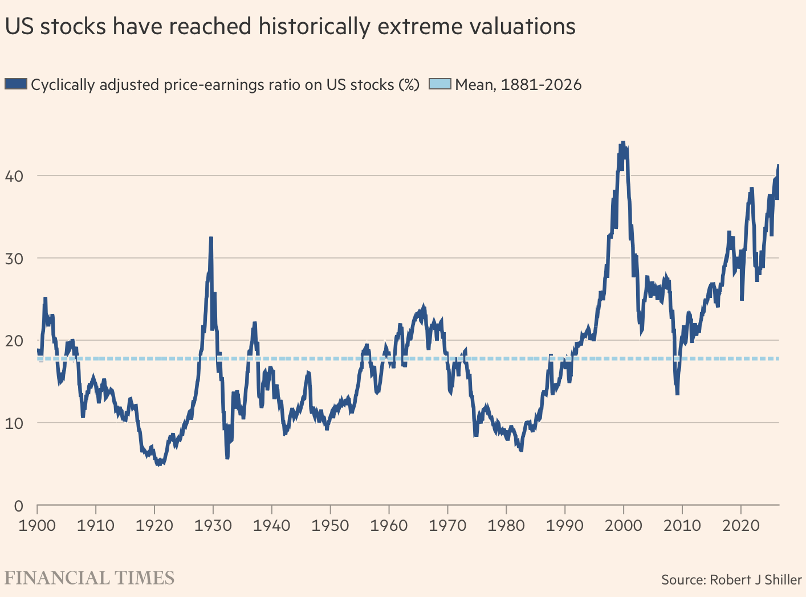
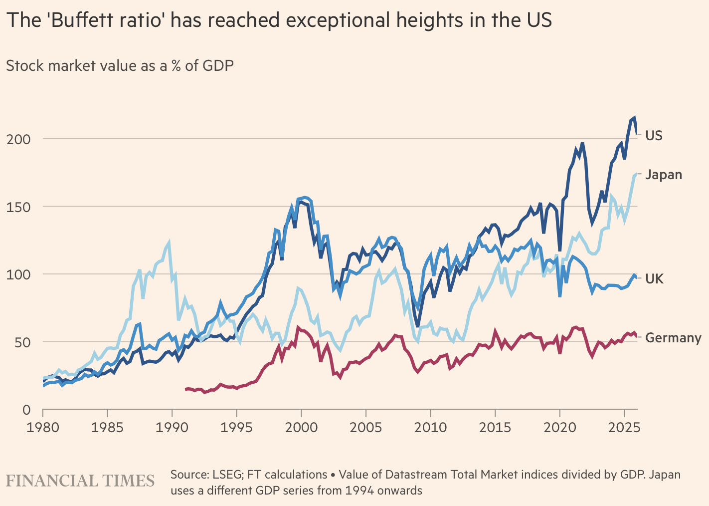
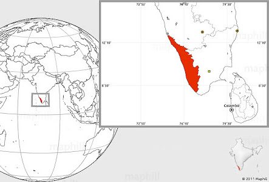
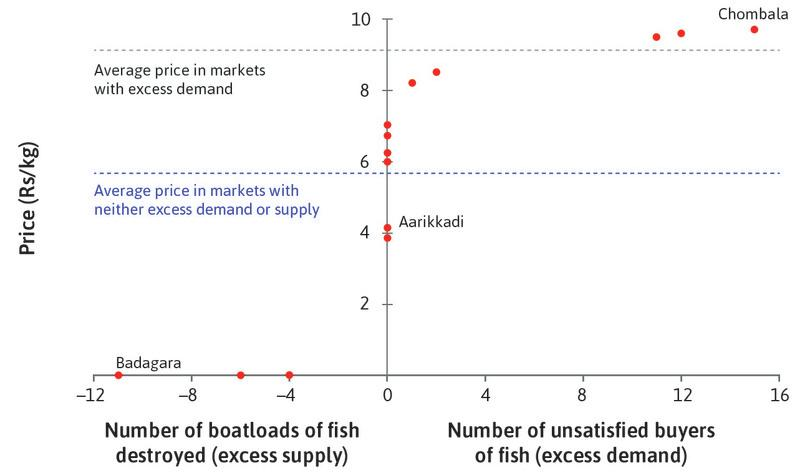
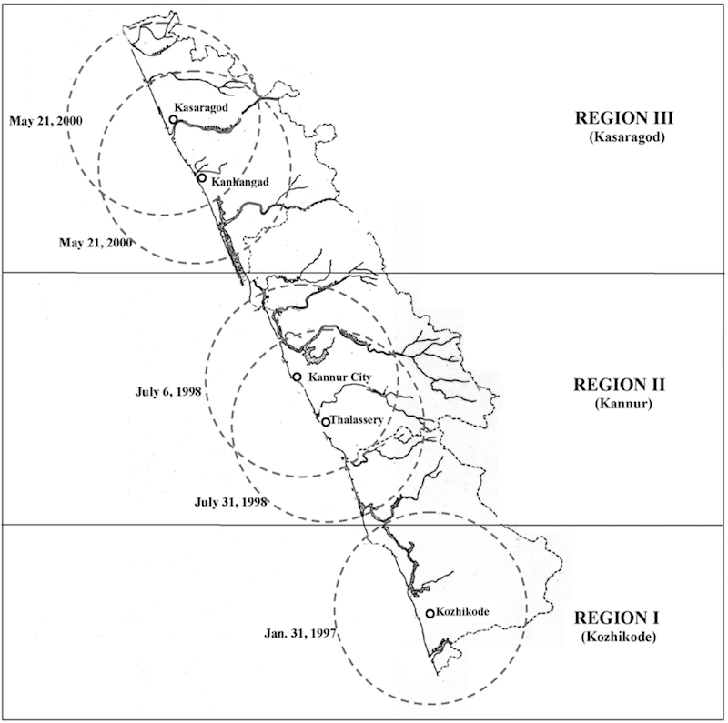
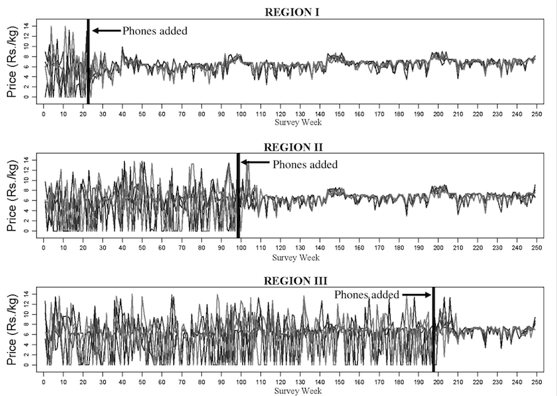
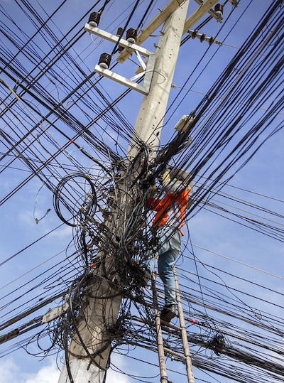
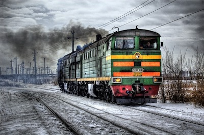
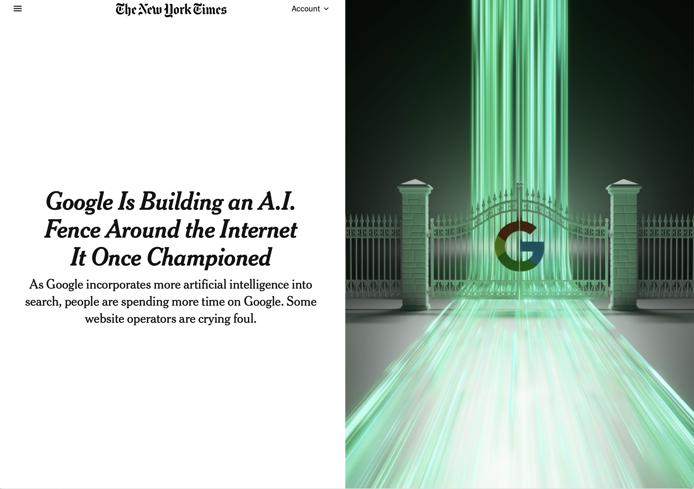

<style>
	#refs {margin-top: 10rem;}
</style>


## Perception about AI

{.pic70}


## Moykr's knowledge

Mokyr would call this practical knowledge "**useful knowledge**" to describe knowledge that helps people understand or manipulate the world around them.

::: fl

- **Prescriptive Knowledge** ($\lambda$-knowledge): 
	- Knowledge of how to do something. It is the recipe, technique, or invention itself. 
		- In this case, it is the knowledge that adding a spoonful of starter curd to warm milk will transform it overnight. No understanding of microbiology is required; one simply has to follow the steps.

:::

::: fr

- **Propositional Knowledge** ($\omega$-knowledge): 
	- Knowledge of why something works. 
		- It consists of scientific principles, natural laws, and systematic explanations. In this case, it is the biological and chemical understanding of bacterial fermentation, enzyme activity, and protein coagulation.


:::


## Perception about AI 

::: fl

#### Cyclically adjusted price/earnings ratio

[CAPE]{.h} is defined as today’s value of the stock market divided by the average of the previous 10 years of earnings per share, both in real terms.

:::


::: fr

{.pic80}

:::

## Perception about AI  

::: fl

####  Buffett indicator

[Buffett indicator]{.h} ratio of the total value of the stock market to GDP

:::

::: fr

{.pic80}

:::

## Coastal Fish Market in Kerala

### @jensen2007digital

{.picr}

- Fish is the staple diet in Kerala, India
	- Kerala has a long coastline with fish markets dotted along the coast

Fisherman have a choice of which fish market they land their fish in

- **Information problem** after the fisherman catch their fish
	- They [**do not know** the **price** of fish in each market]{.h} on a particular day


## Coastal Fish Market in Kerala

### @jensen2007digital

{.picr}

- Fisherman had to **choose** the port/market where they would get the best price for their catch
	- Fish merchants bought the fish from the fisherman and sold it to the consumers
		- If fish merchants already had enough fish on the port they landed, the fisherman would just **jettison** their catch


## Markets dysfunctional 

{.pic70}

## Sequential Roll out of mobile phone technology

&nbsp; 

{.pic40}

##

&nbsp;

{.pic60}

##  Space over which markets operate

{.pic60}

## Movement is an essential part of the modern economy

::: fl

<!-- ### The key movement is flow of information -->

- **New technology** creates new space for information flow 
	- spaces that **did not exist previously**
	- The space are especially customised for the **flow of information**

:::

::: fr

{.pic60}

:::

## Movement is an essential part of the modern economy (2)

::: fl

### Creating space for movement (flow)

**Internal space**

- Requires creating an internal space which facilitates flows 


:::

::: fr

{.pic80}

:::

## Movement is an essential part of the modern economy (2)

::: fl

### Creating space for movement (flow)

**Internal space**

- Requires creating an internal space which facilitates flows 

&nbsp; 

::: {.note .red}

### Rules of the Space

**Rules** that govern the space and objects within it that facilitate the flow within the space 

- isolate the space from external it immediate space
- control **entry** and **exit points**

:::

:::

::: fr

{.pic80}

:::

## Movement is an essential part of the modern economy (3)

::: fl

{.pic80}

:::

::: fr

### Spatial Infrastructure

- There is a specific sub-class of infrastructure that facilitates flow of information with its various intangible design elements that adhere to these rules 

:::


## Three waves of technology


`1960s–1980s`

```
┌-------------------------------------------------------------┐
| 1. Computational Foundation Wave (Data Creation/Storage)    |
|    - Silicon, Microprocessors, Relational Databases         |
└-------------------------------------------------------------┘
```

`1990s–2000s`

```
┌-------------------------------------------------------------┐
| 2. Connectivity & Transmission Wave (Data Flow)             |
|    - Internet, TCP/IP, Cloud, Optical Fiber                 |
└-------------------------------------------------------------┘
```

`2010s–Present`

```
┌-------------------------------------------------------------┐
| 3. Cognitive / Intelligence Wave (Data Interpretation)      |
|    - Neural networks, ML, LLMs                              |
└-------------------------------------------------------------┘
```

## Layers of the AI Stack

&nbsp; 

```
.---------------.                            .----------------------------------.
|  Application  |    ----------------------  |  User interface and experience.  |
'---------------'                            '----------------------------------'
.---------------------.                      .--------------------------------.
|  Cognitive / Model  | -------------------  |  inference / decision-making.  |
'---------------------'                      '--------------------------------'
.-----------------.                          .----------------------------------.
|  Data Pipeline  |  ----------------------  |  sorting, information retrieval  |
'-----------------'                          '----------------------------------'
.-----------------------.                    .---------------.
|  Network / Transport  | -----------------  |  Moving data  |
'-----------------------'                    '---------------'
.---------------------------.                .-------------------------.
|  Infrastructure/Compute   |  ------------  |  Raw physical hardware  |
'---------------------------'                '-------------------------'  
```

## Technology waves

### Each wave created a layer that allows the next technological waves to operate

::: fl


What is the relationship between the different layers

- dynamic complementarity

&nbsp; 

::: {.note .green}

**Dynamic complementarity**

- complementarity
- dynamic

:::


:::


## Market Structure

::: fl

**Market structure** and market capture

- market structure is organisational and competitive **characteristics** of a market. 
- how **competitive** is a particular market segment

:::

## @krugman1987free

- Jumbo jet market


::: fl

**Takeaway** 

- The greater the scale effects, the more fewer the firms in the market
- Scale becomes a strategic tool
- Increase the 

:::

::: fr
 
Why does **market capture** matter? 

- **Dynamic complementarity**


:::

## New York Times article yesterday

@nyt2026google

{.pic60}

## History of Competition Policy

&nbsp; 

### Post-war era 

- state held the power 
- Policies prevented market capture

### 1980s onwards 

::: fl

- we have seen the power shit from the state to private players 

**Silicon Valley Consensus**

- 2000s have increased their market power

:::

## 

::: fl


{.pic80}

:::

::: fr

&nbsp; 

&nbsp; 

### The economics of market capture will determine how the benefits of AI are distributed.

::: 

## 


{.pic40}

